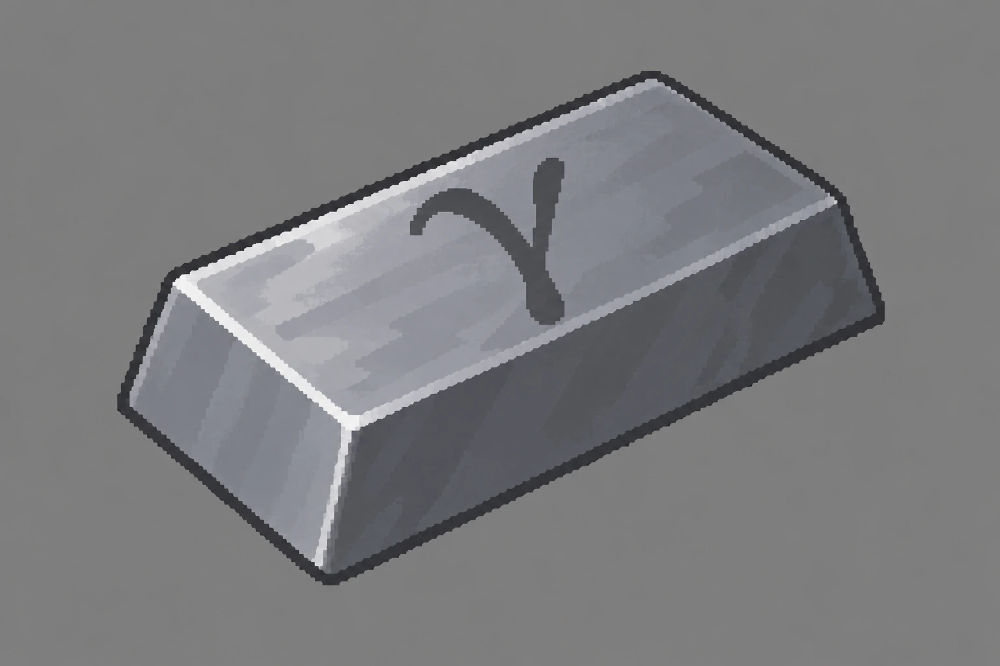
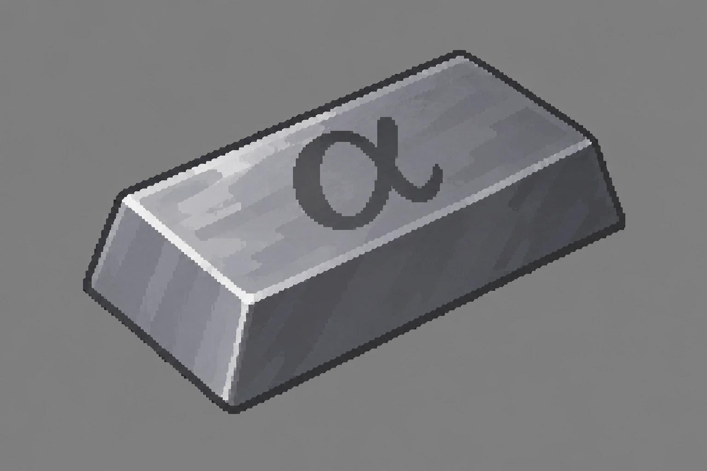

<p align="center">
  
  &nbsp;&nbsp;
  
</p>

<p align="center"><sub><b>Ferrum Gamma</b> &nbsp;·&nbsp; <b>Ferrum Alpha</b></sub></p>

<h1 align="center">Ferrum — a clean, from-scratch chess engine in Rust</h1>

Ferrum is a UCI-compatible chess engine written from scratch in Rust. It
contains no forks and no code borrowed from Stockfish — every line is
intended to be understandable, and the engine is developed solo with an AI
assistant where the human is architect/reviewer and the AI implements.

## Two variants, one repository

Differences are managed with Cargo features. **Ferrum Alpha** is created by
*removing* features from **Ferrum Gamma**, not by separate development:
first comes the common core, then the differences.

| Variant | Build | Threads | Hash (default) |  Quiescence | Evaluation | Design target |
|---|---|---|---|---|---|---|
| **Ferrum Gamma** (standard) | `cargo build --release` (default) | Lazy SMP, `Threads` 1–8 | 64 MB, `Hash` 1–4096 | Yes (`qsearch`) + null-move, LMR, RFP, LMP, futility, razoring | Advanced: tapered MG/EG, mobility, pawn structure, bishop pair, rook files, king safety, trapping terms | ~1900–2000 measured at 300 ms; long-term goal 3500 |
| **Ferrum Alpha** (lightweight) | `cargo build --release --no-default-features` | Single-threaded (`Threads` max 1) | 8 MB | Yes (`qsearch`) + RFP, LMP, futility (no null-move/LMR/razoring) | Simple: material + single PST + defensive king terms | ~1850–1900 measured at 300 ms; goal 2000 |

The name *Alpha* refers to the level, not the stage of development: it is a
fully-fledged lightweight engine, not a test build. Both variants now share
the trained search core (quiescence, reverse futility, late-move pruning,
depth-1 futility) and differ in evaluation, threading and TT size; Gamma
adds null-move, LMR, razoring and check extensions. Overtaking Stockfish is
not a goal — that is unrealistic for a solo project. The targets above are
**design goals** for the feature sets on typical hardware; your measured Elo
depends on time controls, hash size and CPU.

```toml
[features]
default = ["gamma"]
# `qsearch` now means "Gamma's extra aggressive search set": null-move,
# LMR, razoring, check extensions. Quiescence itself is shared core and is
# also on in Alpha.
gamma   = ["threads", "qsearch", "advanced-eval", "large-tt"]
threads = []
qsearch = []
advanced-eval = []
large-tt = []
```

## Quick start

```sh
# Gamma (standard)
cargo build --release
./target/release/ferrum   # UCI engine — connect via any UCI GUI

# Alpha (lightweight)
cargo build --release --no-default-features
./target/release/ferrum

# Tests (both variants must pass)
cargo test
cargo test --no-default-features
cargo test --release
```

Through a GUI: load the binary, set `Hash` (MB) and `Threads`, start a
game. From the terminal you can also drive UCI by hand:

```
uci
isready
position startpos moves e2e4 e7e5
go depth 6
quit
```

Debug helpers (not part of the UCI spec): `d`, `eval`, `perft <n>`,
`divide <n>`.

## Server / bot embedding

The engine builds both a binary and a shared library (`rlib` + `cdylib`).
Servers can load `libferrum.so` / `ferrum.dll` / `libferrum.dylib` through
the C ABI in `src/ffi.rs` and search in-process instead of piping a
subprocess:

```c
FerrumEngine *e = ferrum_create();
ferrum_set_position(e, "startpos", "e2e4 e7e5");
char *json = ferrum_go_json(e, 100, 0, 0, 1);   /* 100 ms */
puts(json);                                      /* bestmove/score/depth/pv */
ferrum_string_free(json);
ferrum_destroy(e);
```

Highlights: one independent handle per game/worker, panic-safe entry points,
atomic position updates (invalid FENs/illegal moves are rejected), strict
FEN validation, `EvalParams`/`SearchParams` options, and `FERRUM_HASH_MB`
for per-instance memory caps in containers. `tools/embed_demo.py` loads the
built library and runs a search; `tools/embed_demo.py --help` has options.

Rust services can run the UCI loop over any reader/writer with
`ferrum::uci::run_with_config` (see `tests/uci_embed.rs`), or use
`ferrum::search::Searcher` directly. A multi-stage `Dockerfile` builds the
binary and the library, runs as a non-root user and caps the default hash.
Full integration notes: [`docs/server.md`](docs/server.md).

The binary also accepts service-friendly initial options:

```sh
ferrum --hash 16 --threads 4 --eval-params "pressure_scale=16,trap_bonus=8"
ferrum --version
```

## Strength probes (examples)

```sh
cargo run --release --example bench    # startpos depth 4/6/7/8: nodes, PV
cargo run --release --example tactics  # mate-in-1/2, win-of-queen, center
cargo run --release --no-default-features --example bench

# In-process paired training match (200 games, same opening for both colours)
cargo run --release --example train -- \
  --a "pressure_scale=16,trap_bonus=8" --b default --games 200 --nodes 20000
# Or drive a full training run (builds the right variant itself):
python tools/train.py --variant gamma --mode spsa --iters 24 --games 200
```

## Design overview

```
src/
  types.rs    Colours, pieces, Move / MoveList, square <-> string.
  bitboard.rs Bitboard type, precomputed leaper tables (built at startup by
              looping over the board — no magic numbers), attack tests.
  sliders.rs  Sliding attacks from occupancy-indexed tables (bishop and rook,
              64 x 4096 entries each), filled at startup by ray walking.
  board.rs    Board (bitboards + mailbox), Zobrist hashing, FEN I/O,
              pseudo-legal movegen + legality filter, make/unmake with an
              undo stack, perft. King captures are never generated.
  eval.rs     Simple (Alpha) vs advanced tapered (Gamma) evaluation.
              PSTs are White-oriented, rank-8-first tables with a documented
              mirror rule. Advanced adds mobility, doubled/isolated/passed
              pawns, bishop pair, rook open/semi files, king-safety, and the
              Gamma playstyle terms (loose-material hunting, trapped pieces,
              enemy-king pressure); the simple eval adds Alpha's king-shield,
              own-loose and tempo terms. Every positional weight lives in
              `EvalParams`, which the training harness can override without
              a rebuild (`setoption name EvalParams value ...`).
  tt.rs       Power-of-two transposition table (hash/depth/flag/score/best/
              age), shared behind a mutex for SMP.
  search.rs   Negamax alpha-beta + PVS, iterative deepening, aspiration
              (re-centered windows — see the comment on the edge case),
              TT, MVV-LVA + killers + history, check extension, razoring,
              repetition / 50-move / insufficient-material draws, mate
              scored as MATE - ply. Both variants add quiescence
              (stand-pat, delta pruning, SEE pruning, check evasions),
              late-move pruning, reverse futility and depth-1 futility;
              Gamma additionally has null-move pruning, late-move
              reduction and check extensions. `SearchParams` exposes each
              pruning for training A/Bs.
  uci.rs      UCI loop: uci/isready/setoption/position/go + in-engine time
              management (go wtime/btime/winc/binc/movestogo/movetime/
              depth/nodes/infinite). Search runs on a background thread so
              `stop`/`quit` never deadlock stdout. `run_with_io`/
              `run_with_config` run the same loop over any reader/writer.
  ffi.rs      C ABI for servers/bots: opaque per-game handles, create/
              destroy, atomic set_position (strict FEN), go/go_json,
              evaluate, options, string ownership, panic containment.
  main.rs     Thin entry point: CLI flags (--hash/--threads/--eval-params/
              --search-params/--version/--help) then the UCI loop.
```

Representation notes:

* Squares are `0..=63` with `a1 = 0`, so the bit index *is* the square
  number. Ranks are `0..=7` (0 = rank 1).
* The board keeps 12 bitboards (`colour*6 + kind`) plus a 64-entry mailbox
  for cheap piece lookups. Occupancy is the OR of all bitboards.
* Zobrist uses a fixed-seed xorshift generator, so hashes are deterministic
  across runs. The hash is maintained incrementally on every make/unmake.
* Leaper tables are generated at startup by explicit board loops; sliding
  attacks come from occupancy-indexed tables (`sliders.rs`) whose contents
  are filled by ray walking at startup — the ray-stepping part is the
  table build, the lookup is O(1). This trades a little raw speed for
  code you can verify by inspection.
* UCI move matching compares only from/to/promotion (flags such as
  `is_double_push` are generation-dependent and must not break matching).

## Playstyles

The two variants deliberately differ in *bias*, not just depth:

* **Gamma** hunts loose material — the advanced eval adds a bonus for
  enemy pieces that are attacked more than they are defended, a bonus for
  enemy pieces with no escape squares (trapped), and a bonus for pressing
  the enemy king ring.
* **Alpha** values king shelter and its own material — the simple eval adds
  a king pawn-shield bonus and an own-loose-material penalty (it will not
  leave pieces hanging), plus a tempo term.

Both are measured A/B changes, not aspirations; `docs/variant-styles.md`
has the anatomy, the numbers and the rejected alternatives.
`docs/training.md` and `tools/train.py` describe how the weights are
trained (in-process paired games, then SPSA / targeted style search).

## Tools

Python helpers under `tools/` (stdlib only, except the texel tools, which
need NumPy):

| Tool | Purpose |
|---|---|
| `gauntlet.py` | UCI match harness — plays paired games against another engine or a Stockfish anchor, writes `results/*.json` |
| `train.py` | Training driver — builds `examples/train` for a variant, runs SPSA over `EvalParams`, then a targeted style search; writes `training/*.json` |
| `embed_demo.py` | Loads the built shared library via `ctypes` and runs an in-process search (server/bot smoke test) |
| `verify_mates.py` | Re-checks mate claims with Ferrum itself (`perft 1 == 0` + mate score) |
| `session_summary.py` | Tabulates every gauntlet JSON in `results/` into one session table |
| `probe_fen.py` | Asks an engine for its best move on a FEN (`go depth N`) |
| `compare_evals.py` | Evaluates a battery of positions with both engines and diffs them |
| `build_corpus.py` | Builds a (FEN, side-to-move) corpus from the gauntlet games |
| `label_corpus.py` | Labels that corpus with Stockfish scores |
| `ferrum_eval.py` | NumPy replica of the Gamma evaluation (used by the tuner) |
| `texel.py` / `texel_fit.py` | Texel feature extraction and weight fitting against Stockfish labels |

## Testing

* Perft against the Chess Programming Wiki reference counts:
  startpos `20/400/8902`, Kiwipete `48/2039/97862`, en-passant position
  `14/191/2812/43238`, promotion position 4 `6/264/9467/422333` and
  position 5 `44/1486/62379/2103487` — all asserted in `board::tests`.
* Search: mate-in-one (`Qxf7#`), win-of-queen (`Nxa8`), stop-flag handling,
  legal root move — in `search::tests` and `examples/tactics.rs`.
* Evaluation: parameter-spec round-trip and unknown-key rejection, the
  loose-material scan, the trapped-piece term, and that trained weights
  actually move the evaluation (`eval::tests`).
* Training harness: `examples/train.rs` compiles and runs for both variants
  (it is an example, not a test); its output is the paired-game evidence in
  `ELO.md`.
* UCI end-to-end (handshake, `go depth`, mate-in-one, clock + `stop`,
  `Threads`/`Hash`/`EvalParams` options, `ucinewgame` full reset) —
  `tests/uci_smoke.rs` spawns the real binary via `CARGO_BIN_EXE_ferrum`.
* Server embedding: `tests/uci_embed.rs` runs the UCI loop over in-memory
  buffers (including a rejected bad FEN); `src/ffi.rs` unit tests cover
  handle lifecycle, search, options, invalid positions and null pointers.
* Protocol rule: while a search is running, `stop` stops it and `position` /
  `ucinewgame` stop-and-join it (printing its `bestmove`, possibly
  `bestmove (none)`) before the board/TT reset — a stale bestmove is never
  attributed to a new position.

## Notes on Elo

See `ELO.md` for the gauntlet method and measured estimates
(`tools/gauntlet.py` vs Stockfish `UCI_Elo` anchors). In short: the
2026-11-15 training run moved Gamma to ~1930 versus the SF 2000 anchor at
300 ms (4–6 in 10 games) and Alpha to ~1870 versus the SF 1800 anchor
(5–3–2 in 10 games), with Alpha gaining ~214 Elo in-process at a fixed
50 ms clock and Gamma ~73 Elo at 80k nodes/move. The variants' long-term
goals are 2000 for Alpha and 3500 for Gamma; neither is reached yet.
Estimates move with TC, Hash and Threads — always use the `--release`
build, and prefer more games / longer controls over single short matches.
At `go movetime 1` Ferrum still measures ≈ 1470–1500 vs Stockfish anchors
(see `ELO.md`); the 2000 target is a ≥300 ms target, not a 1 ms one.
Hitting 2200+ would require more strength work (deeper search, better
eval) rather than better testing.

## License

GPL-3.0-or-later (see `LICENSE`).
